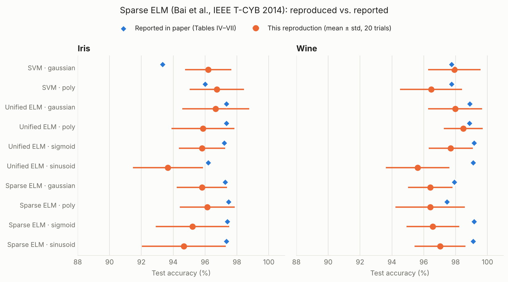

# Reproducing "Sparse Extreme Learning Machine for Classification" (IEEE T-CYB 2014)

This repository reproduces the **Iris** and **Wine** experiments of

> Zuo Bai, Guang-Bin Huang, Danwei Wang, Han Wang, M. Brandon Westover.
> **Sparse Extreme Learning Machine for Classification.**
> *IEEE Transactions on Cybernetics*, 44(10):1858–1870, 2014. doi:[10.1109/TCYB.2014.2298235](https://doi.org/10.1109/TCYB.2014.2298235)
> Open-access author manuscript: <https://pmc.ncbi.nlm.nih.gov/articles/PMC4883115>

**Journal impact factor:** IEEE Transactions on Cybernetics has a Journal Impact Factor of **10.5** (Clarivate JCR, released June 2025), so it meets the IF > 7 requirement.

## 1. What the paper proposes

An **Extreme Learning Machine (ELM)** is a single-hidden-layer network. Its hidden layer h(x) is either random (sigmoid or sinusoid nodes) or a kernel (Gaussian or polynomial), and only the output weights are learned.

* **Unified ELM** (Huang et al., 2012) learns the output weights by ridge regression in closed form:
  f(x) = [K(x,x₁) … K(x,x_N)] (I/C + Ω)⁻¹ T.
  It is accurate, but the solution is **dense**: every training sample is used at test time.
* **Sparse ELM** (this paper) swaps the squared loss for the hinge loss and, unlike an SVM, has **no bias term**. Because there is no bias, the dual problem has only box constraints:

  min ½ αᵀGα − 1ᵀα  s.t. 0 ≤ αᵢ ≤ C,  with Gᵢⱼ = tᵢtⱼ Ω(xᵢ,xⱼ)

  The paper solves this dual by updating **one** variable at a time (its Algorithm 1). The result is a **sparse** model, f(x) = Σₛ αₛ tₛ K(x, xₛ), which keeps only its support vectors.
* **SVM** (LIBSVM) is the baseline.

The paper's claim is that sparse ELM is about as accurate as unified ELM and at least as accurate as SVM, while being sparse and fast to train.

## 2. Why this paper was chosen

| Requirement | How it is met |
|---|---|
| Journal IF > 7 | IEEE T-CYB, JIF 10.5 |
| Easy environment | Pure Python (NumPy, SciPy, scikit-learn). No GPU and no deep-learning framework. |
| Small dataset | Iris (150 samples × 4 features) and Wine (178 × 13). Both **ship with scikit-learn**, so nothing needs to be downloaded. |
| Straightforward to reproduce | The paper gives the full protocol: splits, scaling, number of trials, parameter grid, the selected parameters (Table III), the solver and its stopping rule. A full run takes about 1–4 minutes on a laptop CPU. |

The paper also reports results on 21 other benchmarks (USPS, Satimage, Adult and others). Those datasets must be downloaded from UCI or LIBSVM and are **not** part of this reproduction (see §8).

## 3. Repository layout

```
selm_repro/
├── README.md            ← this file
├── requirements.txt
├── elm.py               ← Unified ELM, Sparse ELM (Algorithm 1 + OAO), SVM wrapper
├── paper_results.py     ← numbers reported in the paper (Tables II, III, IV–VIII)
├── run_experiments.py   ← the experiment protocol; writes results/*.csv|md
├── check_solver.py      ← correctness checks (KKT conditions, compared with a generic QP solver)
├── make_figure.py       ← reproduced vs. reported accuracy plot
└── results/             ← outputs of the runs reported below
```

## 4. Environment setup

Requires Python 3.8 or newer. Tested with Python 3.13, NumPy 2.5, SciPy 1.18, scikit-learn 1.9, pandas 3.0 and matplotlib 3.11. Any reasonably recent versions should work.

**Option A: venv (Windows / macOS / Linux)**

```bash
cd selm_repro
python -m venv .venv
# Windows:      .venv\Scripts\activate
# macOS/Linux:  source .venv/bin/activate
pip install -r requirements.txt
```

**Option B: conda**

```bash
conda create -n selm python=3.11 -y
conda activate selm
pip install -r requirements.txt
```

You do not need a GPU or any dataset download. Iris and Wine are loaded with `sklearn.datasets.load_iris()` and `load_wine()`.

## 5. How to run

Run every command from inside `selm_repro/`.

```bash
# 0) (optional, ~1 s) check that the solver is correct
python check_solver.py

# 1) main reproduction: the paper's selected hyper-parameters (Table III), ~1-2 min
python run_experiments.py

# 2) full protocol: re-select hyper-parameters by 5-fold CV on the paper's grid, ~3-4 min
python run_experiments.py --params cv

# 3) (optional, ~20 s) the paper's "fixed split, shuffled 20 times" protocol
python run_experiments.py --protocol fixed

# 4) figures (results/summary_*.png)
python make_figure.py
python make_figure.py --summary results/summary_cv_random.csv
```

Each run prints a Markdown table comparing our results with the paper's and writes these files to `results/` (the tag is, e.g., `paper_random`):

| File | Content |
|---|---|
| `summary_<tag>.md` / `.csv` | mean ± std test accuracy, the paper's value, the difference, #SV and train accuracy |
| `per_trial_<tag>.csv` | every trial: accuracy, #SV, train and test time |
| `params_<tag>.csv` | the hyper-parameters used, next to the paper's |

Useful options: `--trials 20`, `--seed 0`, `--hidden 1000` (number of random hidden nodes L), `--datasets iris wine` and `--out results`. Run `python run_experiments.py -h` for the full list.

## 6. Experimental protocol (as in Section VI of the paper)

| Item | Paper | This code |
|---|---|---|
| Train/test sizes | Iris 75/75, Wine 89/89 | same |
| Scaling | attributes linearly scaled to [−1, 1] using training-set factors | same (`MinMaxScaler(-1, 1)` fit on the training set) |
| Trials | 20 | 20 |
| Multiclass | OAO for SVM and sparse ELM; unified ELM is multi-output | same; targets ±1, OAO by majority vote |
| Kernels | Gaussian exp(−‖u−v‖²/2σ²), polynomial (u·v+1)ᵐ | same |
| Random nodes | sigmoid, sinusoid; L = 1000 for multiclass | same; a ~ U[−1,1], b ~ U[0,1] (see §8) |
| Grid | C, σ ∈ {0.01, 0.1, 0.2, 0.5, 1, 2, 5, 10, 20, 50, 100, 200, 500, 1000}, m ∈ {1,…,5} | same |
| Model selection | 5-fold CV on the training data | same (`--params cv`), on the first training split |
| Sparse ELM solver | Algorithm 1: one α per step, c = argminᵢ gᵢdᵢ, clipped Newton step, stop when min J > −ε, ε = 10⁻³ | same (`elm.solve_sparse_elm_dual`) |
| SVM | "SVM and Kernel Methods MATLAB Toolbox" | scikit-learn `SVC` (LIBSVM), tol = 10⁻³ |

## 7. Results

All accuracies are on the test set, as mean ± std over 20 trials. "Paper" values come from Tables IV–VII. The paper does not publish its single fixed train/test split, so the main tables use **20 random stratified splits** of the same sizes. The paper's standard deviation of 0 for the deterministic kernel methods reflects that fixed split.

### 7.1 Main run: the paper's hyper-parameters (`python run_experiments.py`)

**Iris** (75 train / 75 test)

| Method | Mapping | Test acc. (ours) | Test acc. (paper) | Diff | #SV (ours) | #SV (paper) |
|---|---|---|---|---|---|---|
| SVM | Gaussian | 96.20 ± 1.45 | 93.33 | +2.87 | 21.2 | 29 |
| SVM | poly | 96.73 ± 1.70 | 96.00 | +0.73 | 17.1 | 23 |
| Unified ELM | Gaussian | 96.67 ± 2.10 | 97.33 | −0.66 | dense (75) | – |
| Unified ELM | poly | 95.87 ± 1.98 | 97.33 | −1.46 | dense (75) | – |
| Unified ELM | sigmoid | 95.80 ± 1.45 | 97.20 | −1.40 | dense (75) | – |
| Unified ELM | sinusoid | 93.67 ± 2.20 | 96.20 | −2.53 | dense (75) | – |
| **Sparse ELM** | Gaussian | 95.80 ± 1.58 | 97.27 ± 1.60 | −1.47 | 53.5 | 54.45 |
| **Sparse ELM** | poly | 96.13 ± 1.72 | 97.47 ± 1.66 | −1.34 | 22.9 | 38.4 |
| **Sparse ELM** | sigmoid | 95.20 ± 2.31 | 97.40 ± 0.66 | −2.20 | 12.4 | 46.8 |
| **Sparse ELM** | sinusoid | 94.67 ± 2.63 | 97.33 ± 0.42 | −2.66 | 13.9 | 47.4 |

**Wine** (89 train / 89 test)

| Method | Mapping | Test acc. (ours) | Test acc. (paper) | Diff | #SV (ours) | #SV (paper) |
|---|---|---|---|---|---|---|
| SVM | Gaussian | 97.92 ± 1.64 | 97.75 | +0.17 | 49.0 | 72 |
| SVM | poly | 96.46 ± 1.94 | 97.75 | −1.29 | 33.5 | 46 |
| Unified ELM | Gaussian | 97.98 ± 1.69 | 98.89 | −0.91 | dense (89) | – |
| Unified ELM | poly | 98.48 ± 1.22 | 98.88 | −0.40 | dense (89) | – |
| Unified ELM | sigmoid | 97.70 ± 1.39 | 99.16 | −1.46 | dense (89) | – |
| Unified ELM | sinusoid | 95.62 ± 1.99 | 99.10 | −3.48 | dense (89) | – |
| **Sparse ELM** | Gaussian | 96.40 ± 1.39 | 97.92 ± 0.82 | −1.52 | 168.1 | 149.05 |
| **Sparse ELM** | poly | 96.40 ± 2.18 | 97.46 ± 1.89 | −1.06 | 40.5 | 49.9 |
| **Sparse ELM** | sigmoid | 96.57 ± 1.65 | 99.16 ± 0.70 | −2.59 | 26.9 | 54.55 |
| **Sparse ELM** | sinusoid | 97.02 ± 1.60 | 99.10 ± 0.84 | −2.08 | 37.4 | 53.25 |



### 7.2 Full protocol: hyper-parameters re-selected by 5-fold CV (`--params cv`)

The CV-selected hyper-parameters are in `results/params_cv_random.csv`. With this setting the gap to the paper shrinks: the mean absolute difference over the 20 method/dataset cells is **1.11 points**, and **15 of 20** cells are within one standard deviation of the paper's value. With the paper's own hyper-parameters (§7.1) the figures are 1.61 points and 12 of 20. The full table is in `results/summary_cv_random.md`. Selected rows:

| Dataset | SVM-Gauss | Unified ELM-Gauss | Sparse ELM-Gauss | Sparse ELM-poly |
|---|---|---|---|---|
| Iris (ours) | 96.53 ± 1.58 | 95.93 ± 2.39 | 96.53 ± 1.58 | 95.73 ± 2.06 |
| Iris (paper) | 93.33 | 97.33 | 97.27 ± 1.60 | 97.47 ± 1.66 |
| Wine (ours) | 97.87 ± 1.20 | 98.09 ± 0.90 | 97.30 ± 1.61 | 97.47 ± 1.58 |
| Wine (paper) | 97.75 | 98.89 | 97.92 ± 0.82 | 97.46 ± 1.89 |

### 7.3 The paper's fixed-split protocol (`--protocol fixed`)

With a single split shuffled 20 times, our SVM and kernel-ELM results have **std = 0, as in the paper**, which confirms how the paper's protocol works. Our split (seed 0) gives SVM-Gaussian 93.33% on Iris, **identical to the paper**. The other numbers depend strongly on which 75 samples land in the test set: one Iris test sample is worth 1.33 points. This is why §7.1 and §7.2 average over random splits instead. See `results/summary_paper_fixed.md`.

### 7.4 Verdict

| Claim in the paper | Reproduced? |
|---|---|
| Sparse ELM reaches accuracy comparable to unified ELM and SVM on Iris and Wine | **Yes.** All three are within about 1–2 points of each other and within about one std of the paper's values. |
| Sparse ELM is **sparse**: it uses only part of the training samples, while unified ELM uses all of them | **Yes.** For example, on Iris with the Gaussian kernel we get 53.5 SVs summed over the OAO sub-problems (paper: 54.45), whereas unified ELM keeps all 75 samples. |
| Sparse ELM clearly beats SVM on Iris (97.27 vs. 93.33) | **Not in general.** On our split we also get SVM = 93.33, but over 20 random splits SVM averages 96.2–96.5%, level with sparse ELM. The paper's 4-point gap looks specific to its split. |
| Absolute accuracies | Ours are on average 0.7–1.2 points lower (CV / paper hyper-parameters). Most of that is split-to-split variance on 75–89 test samples. |

`check_solver.py` additionally shows that our implementation of Algorithm 1 reaches the same dual optimum as SciPy's generic box-constrained solver (L-BFGS-B), to 8 decimal places, with KKT violation below 10⁻⁶.

## 8. Deviations and unknowns (please read)

1. **Train/test split.** The paper uses one fixed 50/50 split per dataset but does not publish it. We therefore report 20 random stratified splits (main) and one seed-0 split (`--protocol fixed`).
2. **Random hidden-node distribution.** The paper says only that aᵢ and bᵢ are "randomly generated". We use the convention of the reference ELM code from Huang's group: a ~ U[−1,1], b ~ U[0,1]. With the paper's C values our sigmoid/sinusoid models fit the training data more tightly than the paper's (train accuracy ≈ 100% vs. ≈ 97–99%) and keep fewer SVs. This is the main source of the larger gaps (2–3.5 points) in the sigmoid and sinusoid rows.
3. **Tie-breaking in CV.** With only 60–71 training samples per fold, many grid points tie, and the paper does not say how ties are broken. We pick the simplest tied model: largest σ or lowest degree m, then smallest C. As a result, some CV-selected values differ from the paper's Table III.
4. **SV counting.** For sparse ELM, SVs are summed over the OAO sub-problems. This matches the paper, whose Wine count of 149 exceeds the 89 training samples. For SVM, scikit-learn counts each training sample at most once.
5. **Timing.** The paper used MATLAB on an i5-2400, while this code is NumPy and LIBSVM. Training times are saved in `per_trial_*.csv` but are not comparable with the paper's.
6. **Scope.** Only Iris and Wine are reproduced. To extend the reproduction, add a loader to `LOADERS`, add the split size to `SPLIT` and add the paper's numbers in `paper_results.py`. The other datasets (e.g. USPS, Satimage, Segment) are available on the LIBSVM datasets page.

## 9. Citation

```bibtex
@article{bai2014sparse,
  title   = {Sparse Extreme Learning Machine for Classification},
  author  = {Bai, Zuo and Huang, Guang-Bin and Wang, Danwei and Wang, Han and Westover, M. Brandon},
  journal = {IEEE Transactions on Cybernetics},
  volume  = {44}, number = {10}, pages = {1858--1870}, year = {2014},
  doi     = {10.1109/TCYB.2014.2298235}
}
```
